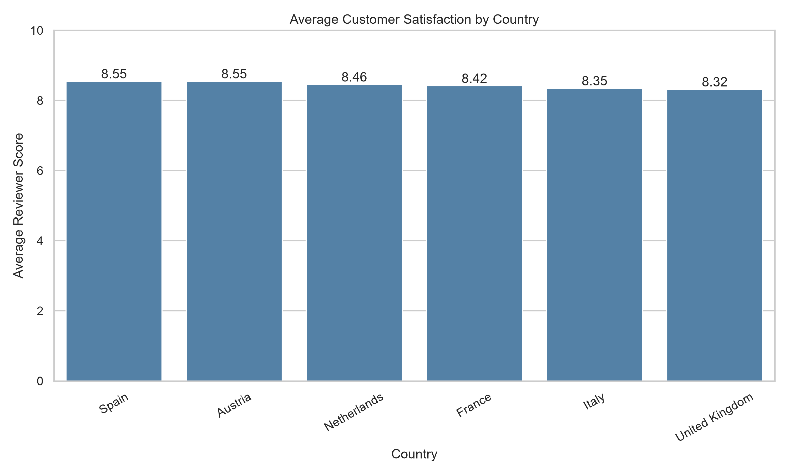
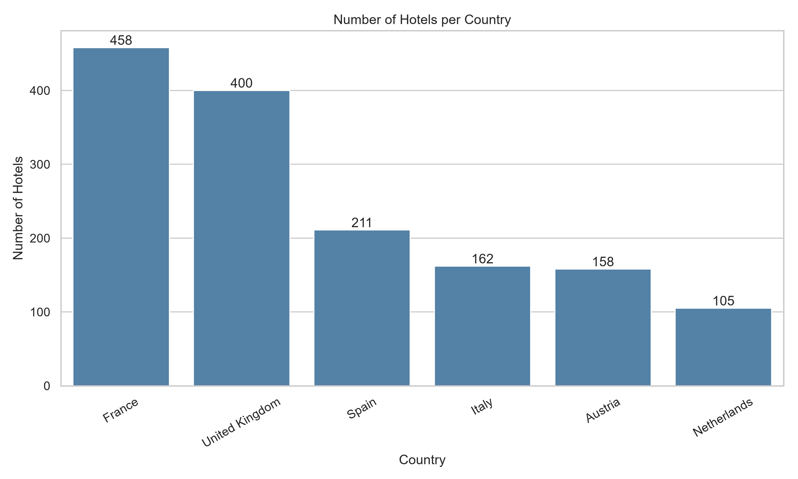
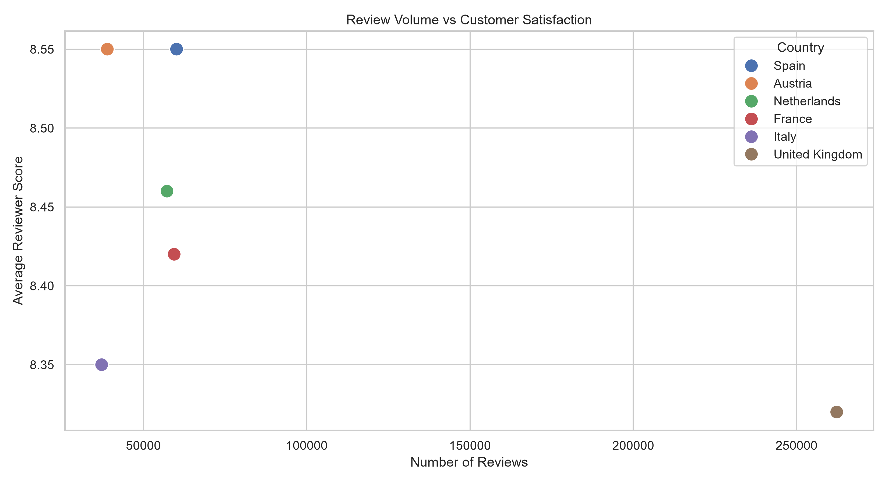

# European Hotel Reviews Analysis

## 1. Project Overview

This project was developed as part of the Programming
for Data Science course at ESILV.

The objective is to analyze European hotel reviews
using the Knowledge Discovery in Databases (KDD)
process and identify meaningful insights into customer
satisfaction, review patterns, temporal trends and
geographical hotel distribution.

## 2. Project Objectives

The project addresses four analytical queries:

- Query 1: Country-level grouping and aggregation.
- Query 2: Frequent patterns in customer reviews.
- Query 3: Temporal analysis and forecasting.
- Query 4: Spatial clustering of hotels.

An interactive dashboard will bring together the
results of the four analytical queries.

## 3. Dataset Description

The project uses the Hotel_Reviews.csv dataset,
containing hotel reviews from six European countries.

### Original dataset

- Number of observations: 515,738
- Number of variables: 17
- Distinct hotel names: 1,492
- Number of countries: 6
- First review date: August 4, 2015
- Last review date: August 3, 2017

### Main variables

| Variable | Description |
|---|---|
| Hotel_Name | Name of the hotel |
| Hotel_Address | Hotel address |
| Review_Date | Date of the customer review |
| Reviewer_Score | Individual customer rating |
| Average_Score | Overall hotel rating |
| Positive_Review | Positive customer feedback |
| Negative_Review | Negative customer feedback |
| Reviewer_Nationality | Customer nationality |
| Tags | Additional review information |
| lat | Hotel latitude |
| lng | Hotel longitude |

## 4. Project Structure

```text
hotel-reviews-analysis-Programming/
├── data/
│   ├── raw/
│   └── processed/
├── notebooks/
├── results/
├── src/
│   ├── __init__.py
│   ├── data_preparation.py
│   ├── eda_visualization.py
│   ├── preprocessing.py
│   ├── aggregation.py
│   ├── aggregation_visualization.py
│   ├── pattern_mining.py
│   ├── forecasting.py
│   ├── spatial_clustering.py
│   └── dashboard.py
├── tests/
│   ├── test_preprocessing.py
│   └── test_aggregation.py
├── main.py
├── requirements.txt
├── README.md
└── .gitignore
```

## 5. Installation

### Clone the repository

```bash
git clone https://github.com/chaymaaaaa/hotel-reviews-analysis-Programming.git
cd hotel-reviews-analysis-Programming
```

### Create a virtual environment

```bash
python -m venv .venv
```

### Activate the environment on Windows PowerShell

```powershell
.\.venv\Scripts\Activate.ps1
```

### Activate the environment on Linux or macOS

```bash
source .venv/bin/activate
```

### Install dependencies

```bash
python -m pip install -r requirements.txt
```

Python 3.12.10 was used during development.

## 6. Dataset Setup

Place the original dataset in:

```text
data/raw/Hotel_Reviews.csv
```

The original and processed datasets are excluded
from GitHub because of their large file sizes.

The preprocessing pipeline automatically generates:

```text
data/processed/hotel_reviews_cleaned.csv
```

## 7. Exploratory Data Analysis

The exploratory analysis includes:

- Dataset dimensions and variable types.
- Missing values and missing percentages.
- Duplicate records.
- Numerical descriptive statistics.
- Temporal coverage.
- Geographical coverage.
- Reviewer score distribution.

Three EDA visualizations are generated:

- Reviewer score distribution.
- Number of reviews per country.
- Monthly review trends.

The visualizations are stored in the results folder.

## 8. Data Preprocessing

The preprocessing pipeline performs the following
operations:

- Removal of 526 exact duplicate records.
- Conversion of review dates into datetime format.
- Removal of unnecessary leading and trailing spaces.
- Extraction of hotel countries from addresses.
- Creation of a unique hotel identifier based on
  hotel name and address.
- Preservation of missing geographical coordinates
  for non-spatial analyses.

### Preprocessing results

| Indicator | Before | After |
|---|---:|---:|
| Reviews | 515,738 | 515,212 |
| Variables | 17 | 19 |
| Missing latitude | 3,268 | 3,268 |
| Missing longitude | 3,268 | 3,268 |
| Invalid dates | 0 | 0 |
| Unidentified countries | 0 | 0 |

The cleaned dataset contains 1,494 distinct
hotel name-address identifiers.

### New variables

- Country: Country extracted from the hotel address.
- Hotel_ID: Identifier combining hotel name and address.

When loading the cleaned CSV independently, parse
Review_Date again because CSV does not preserve
datetime data types.

## 9. Query 1 - Grouping and Aggregation

### Research question

How does customer satisfaction vary across European
countries, and how does it relate to the number of
hotels and reviews in each country?

### Methodology

The cleaned dataset is grouped by Country using
the pandas groupby() and agg() functions.

The following indicators are calculated:

- Number of reviews.
- Number of distinct hotel identifiers.
- Average reviewer score.
- Median reviewer score.

### Results

| Country | Reviews | Hotels | Mean | Median |
|---|---:|---:|---:|---:|
| Spain | 60,149 | 211 | 8.55 | 9.2 |
| Austria | 38,937 | 158 | 8.55 | 8.8 |
| Netherlands | 57,211 | 105 | 8.46 | 8.8 |
| France | 59,413 | 458 | 8.42 | 8.8 |
| Italy | 37,204 | 162 | 8.35 | 8.8 |
| United Kingdom | 262,298 | 400 | 8.32 | 8.8 |

Spain and Austria have the highest rounded average
reviewer scores, while the United Kingdom has the
largest review volume and the lowest average score.

France has the largest number of distinct hotel
identifiers in the dataset.

### Visualizations

#### Average customer satisfaction by country



#### Number of hotels per country



#### Review volume versus customer satisfaction



### Limitations

The average reviewer score is review-weighted,
meaning that hotels with more reviews contribute
more to the country-level average.

The dataset is geographically imbalanced.

The scatter plot contains only six country-level
observations and does not establish causality.

Hotel identifiers are based on names and addresses
and may be affected by address inconsistencies.

## 10. Query 2 - Frequent Pattern Mining

Status: Under development.

## 11. Query 3 - Temporal Forecasting

Status: Under development.

## 12. Query 4 - Spatial Clustering

Status: Under development.

## 13. Interactive Dashboard

Status: Under development.

## 14. Running the Project

Execute the current analysis pipeline:

```bash
python main.py
```

The pipeline currently performs:

1. Dataset loading.
2. Exploratory data analysis.
3. EDA visualization.
4. Data preprocessing.
5. Cleaned dataset generation.
6. Country-level aggregation.
7. Query 1 visualization.

The remaining analytical modules will be integrated
during the next development phase.

## 15. Testing

The project uses pytest for unit testing.

Run all tests using:

```bash
python -m pytest tests/ -v
```

Current test results:

- Preprocessing: 7 passed.
- Aggregation: 7 passed.
- Total: 14 passed.
- Failed: 0.

The tests use controlled synthetic datasets to
validate the core functionality independently
of the original dataset.

## 16. Team Responsibilities

| Member | Responsibility |
|---|---|
| Chayma | GitHub management, EDA, preprocessing and Query 1 |
| Maryem | Query 2 - Frequent pattern mining |
| Adam | Query 3 - Temporal forecasting and notebook integration |
| Yousef | Query 4 - Spatial clustering and dashboard |

## 17. Development Status

- [x] Project initialization
- [x] Exploratory data analysis
- [x] Data preprocessing
- [x] Query 1 implementation
- [x] Query 1 visualizations
- [x] Unit testing for preprocessing and Query 1
- [ ] Query 2 implementation
- [ ] Query 3 implementation
- [ ] Query 4 implementation
- [ ] Interactive dashboard
- [ ] Final notebook integration
- [ ] Final presentation

## 18. Academic Context

Institution: ESILV

Course: Programming for Data Science

Professor: Hugo Alatrista-Salas

Academic year: 2026-2027